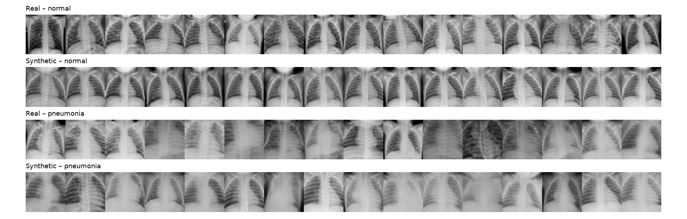

# PneumoGAN

Conditional DCGAN augmentation for imbalanced chest X-ray classification, evaluated on PneumoniaMNIST at 64 × 64 resolution.

This course project asks whether generated minority-class images improve a downstream pneumonia classifier, how they compare with classical augmentation and oversampling, and what changes when only 10% of the NORMAL training images remain. It includes the models, experiment scripts, recorded results, a GAN explainer, and a French presentation.

## Approach

The generator combines a noise vector with a learned class-label embedding. The discriminator uses spectral normalization and a projection head for class conditioning. Training uses the non-saturating adversarial objective and an exponential moving average of generator weights; the scarcity experiment also enables differentiable translation augmentation.

Both experiments use the official training, validation, and test splits. GAN training uses only training images. The NORMAL class is the minority class:

| Experiment | NORMAL training images | PNEUMONIA training images |
|---|---:|---:|
| Full data | 1,214 | 3,494 |
| Minority scarcity | 121 | 3,494 |

Evaluation covers seven classifier-training strategies across three classifier seeds: real data only, classical augmentation, oversampling, GAN balancing, GAN balancing plus classical augmentation, additional GAN samples, and train-on-synthetic/test-on-real (TSTR).

Direct evaluation reports Inception and domain-specific Fréchet distances alongside real-train versus real-test references. Real-versus-synthetic grids and adversarial training curves support visual inspection.

## Setup

From the repository root:

```bash
python3 -m venv .venv
.venv/bin/python -m pip install torch torchvision numpy medmnist scipy scikit-learn matplotlib
```

The dataset downloads automatically into `data/`. PyTorch uses CUDA when available and otherwise falls back to CPU. Use a PyTorch installation compatible with your GPU if you want CUDA acceleration. Inception evaluation may also download pretrained weights on its first run.

Model checkpoints, downloaded data, and the local environment are excluded from Git. The repository includes recorded metrics and sample images, so the results can be reviewed before training.

## Run the experiments

Run both complete experiments with their default settings:

```bash
./run_all.sh
```

To run the stages individually:

```bash
# Full training set
.venv/bin/python src/train_gan.py --out results/gan_full
.venv/bin/python src/evaluate.py --gan results/gan_full --out results/eval_full

# Retain 10% of the NORMAL training images
.venv/bin/python src/train_gan.py --out results/gan_normal10 --minority-fraction 0.1 --diffaug
.venv/bin/python src/evaluate.py --gan results/gan_normal10 --out results/eval_normal10
```

Default GAN training uses 15,000 iterations, batches of 64, a 100-dimensional noise vector, and Adam learning rates of `2e-4` for both networks. Classifier evaluation uses three seeds and 15 epochs. Run either script with `--help` for its options; `--skip-inception` omits Inception FID during evaluation.

Train the corresponding GAN before evaluating it: evaluation reads `checkpoint.pt` from the folder passed through `--gan`.

## Recorded results

Balanced accuracy on 624 real test X-rays, reported as mean ± standard deviation across three classifier seeds:

| Classifier training strategy | Full data | Minority scarcity |
|---|---:|---:|
| Real only | 0.868 ± 0.037 | 0.709 ± 0.033 |
| Classical augmentation | 0.910 ± 0.028 | 0.761 ± 0.039 |
| Oversampling | 0.858 ± 0.019 | 0.711 ± 0.053 |
| GAN balancing | 0.843 ± 0.016 | 0.689 ± 0.011 |
| **GAN balancing + classical augmentation** | **0.920 ± 0.014** | **0.783 ± 0.016** |
| Additional GAN samples (`gan_double`) | 0.850 ± 0.006 | 0.663 ± 0.005 |
| Synthetic only (TSTR) | 0.825 ± 0.014 | 0.676 ± 0.065 |

GAN balancing combined with classical augmentation has the highest mean balanced accuracy in both recorded experiments. GAN balancing alone performs below classical augmentation and oversampling. These results concern one dataset and training configuration; three classifier seeds do not establish a general advantage for GAN augmentation or measure variation across independent GAN training runs.

Full metrics, including AUC, macro-F1, class recalls, and Fréchet distances:

- [Full-data evaluation](results/eval_full/results.md)
- [Minority-scarcity evaluation](results/eval_normal10/results.md)
- [Full-data metrics as JSON](results/eval_full/results.json)
- [Minority-scarcity metrics as JSON](results/eval_normal10/results.json)



## Project files

| Path | Contents |
|---|---|
| [src/data.py](src/data.py) | Dataset loading, normalization, and minority-class subsampling |
| [src/models.py](src/models.py) | Conditional generator, projection discriminator, and CNN classifier |
| [src/train_gan.py](src/train_gan.py) | GAN training, generator EMA, checkpoints, logs, and sample grids |
| [src/evaluate.py](src/evaluate.py) | Classifier experiments, TSTR, Fréchet distances, and evaluation figures |
| [run_all.sh](run_all.sh) | Full-data and scarcity experiment runner |
| [GAN explainer](docs/1_GANs_explained.md) | GAN foundations and summaries of the two systematic reviews |
| [results/](results/) | Recorded training logs, sample grids, figures, and evaluation tables |
| [presentation/](presentation/) | French presentation, figure-generation scripts, PPTX, and PDF |

## Presentation

The presentation is generated from the measured evaluation JSON files. To rebuild the PowerPoint using the committed figures:

```bash
.venv/bin/python -m pip install python-pptx
.venv/bin/python presentation/build_presentation.py
```

After training the full-data GAN, regenerate the French figures with:

```bash
.venv/bin/python presentation/make_figures_fr.py
.venv/bin/python presentation/build_presentation.py
```

The committed [PDF](presentation/Presentation_GAN_Augmentation_Radiographies.pdf) and [PowerPoint](presentation/Presentation_GAN_Augmentation_Radiographies.pptx) are available for direct viewing. The build script writes the PowerPoint; PDF export is a separate step.

## References

The project is motivated by two systematic reviews:

- Akpinar et al., *Synthetic Data Generation via Generative Adversarial Networks in Healthcare: A Systematic Review of Image- and Signal-Based Studies*. [DOI: 10.1109/OJEMB.2024.3508472](https://doi.org/10.1109/OJEMB.2024.3508472).
- Makhlouf et al., *The use of generative adversarial networks in medical image augmentation*. [DOI: 10.1007/s00521-023-09100-z](https://doi.org/10.1007/s00521-023-09100-z).
